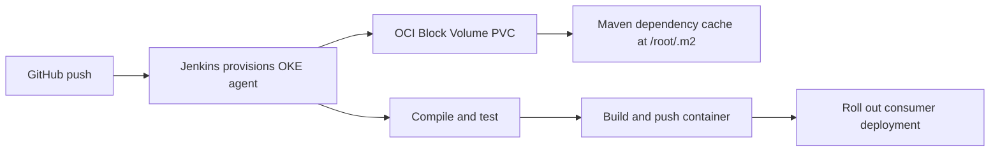
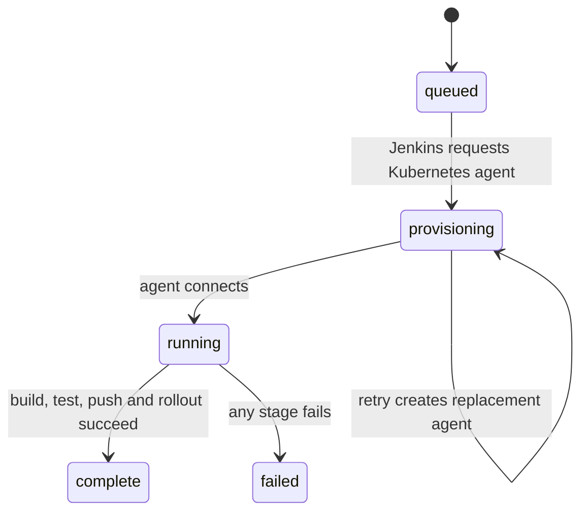

# Jenkins consumer pipeline performance

## Pipeline and cache flow

## ????

1. Read Jenkins build #64 timings and console. It took about 29 minutes total, with 21 minutes reported as Buildable and 7m54s of pipeline subtasks; the log shows three provisioned agent pods before the executor connected. This identifies agent provisioning/wait as the main delay, not the consumer's compilation alone.
2. The existing `/root/.m2` volume was `emptyDir`, so each new pod lost Maven artifacts. Added a regression test first, then changed the Maven mount to a dedicated `oci-bv` ReadWriteOnce PVC, sized at 5Gi. The PVC can be shared safely because `disableConcurrentBuilds()` permits only one consumer build at a time.
3. No secrets or external credentials are added. The claim contains only Maven artifacts. The cache PVC was created in the default namespace; `WaitForFirstConsumer` binds it when the next build schedules its pod.
4. Run `python -m unittest tests.test_jenkinsfile_perf -v` before changing pod requests or retry behavior. To verify rollout, trigger one consumer build, confirm the PVC becomes Bound, the Maven logs show cached dependencies on the next run, compare Jenkins Timings, and inspect failed pod events if agent provisioning still retries.
5. The cache addresses repeat dependency downloads; it does not by itself fix OKE agent provisioning. If multiple replacement pods continue, diagnose pod events and Jenkins Kubernetes plugin logs before changing cluster-wide CPU reservations.
